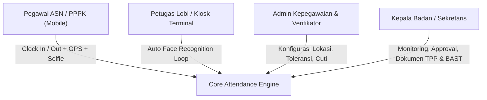
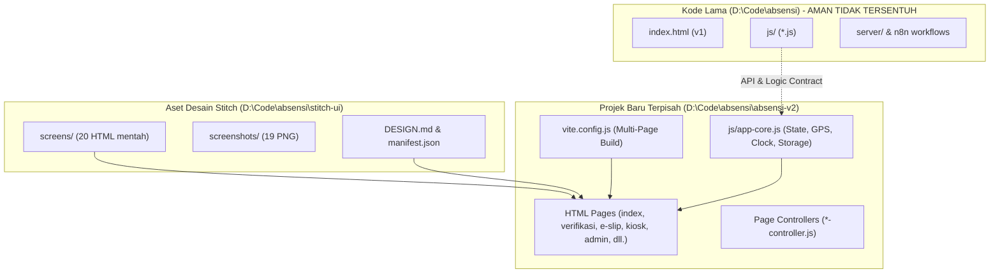
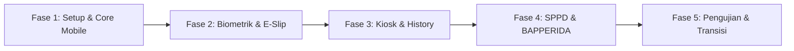

# Product Requirements Document (PRD)
## Penerapan Desain & Fitur Google Stitch ke Sistem Presensi BAPPERIDA Sumba Barat

> **Status:** Draft / Ready for Review  
> **Target Kode Sumber:** `D:\Code\absensi` (Tidak ada berkas eksisting yang dimodifikasi langsung)  
> **Dokumentasi Terkait:** `D:\Code\absensi\stitch-ui\DESIGN.md`, `manifest.json`  
> **Versi:** 1.0.0 — November 2026

---

## 1. Executive Summary & Objective

### 1.1 Latar Belakang
Sistem presensi internal saat ini (`D:\Code\absensi` / `absensi.mindcloud.my.id`) telah memiliki logika bisnis backend dan modul data yang sangat matang (PostgreSQL via n8n, Human.js face recognition, geofencing, SPPD, dan manajemen aset SIMAPO). Namun, tampilan antarmuka saat ini berbasis monolitik single-file HTML (`index.html` ~300KB) dengan gaya visual legacy.

Melalui eksplorasi Google Stitch MCP, telah dirancang sistem antarmuka **20 layar** bertema *Vibrant Enterprise Mobile Attendance* yang modern, ergonomis, berfokus pada thumb-zone mobile, serta memiliki mode desktop/kiosk yang bersih dan bebas dari visual slop.

### 1.2 Tujuan Dokumen (Objective)
Dokumen PRD ini mendefinisikan:
1. **Spesifikasi fungsional dan UI/UX** dari setiap layar Stitch untuk dipadukan dengan logika sistem presensi yang ada.
2. **Matriks pemetaan fitur (Mapping Matrix)** antara layar Stitch dengan modul JavaScript aktif (`absen.js`, `face.js`, `gps.js`, `simapo.js`, `arsip.js`, dll.).
3. **Arsitektur transisi nol-gangguan (Zero-Disruption Architecture)**: Mengembangkan implementasi baru secara modular di folder terpisah (`absensi-v2`) sehingga kode produksi di `D:\Code\absensi` tidak tersentuh atau rusak selama proses transisi.

---

## 2. User Personas & Lingkup Pengguna

1. **Pegawai Lapangan & Kantor (ASN / PPPK / Non-ASN):**
   * Menggunakan smartphone (layar 360px - 428px) untuk presensi masuk/pulang harian.
   * Kebutuhan: Validasi GPS cepat (<3 detik), kamera selfie biometrik anti-lag, kejelasan status keterlambatan, dan struk digital (E-Slip).
2. **Operator / Tamu Meja Lobi (Mode Kiosk):**
   * Menggunakan tablet/monitor touchscreen statis di meja resepsionis kantor BAPPERIDA.
   * Kebutuhan: Kamera scan wajah live terus menerus, umpan balik suara instan, counter kehadiran live.
3. **Administrator Kepegawaian & Kasubag Umum:**
   * Menggunakan desktop/laptop.
   * Kebutuhan: Penyesuaian radius geofence kantor, toleransi jam kerja, persetujuan dinas luar/izin, dan ekspor dokumen TPP.
4. **Pengelola Aset & SPPD (BAPPERIDA):**
   * Kebutuhan: Manajemen KIR ruangan, cetak BAST, dan penugasan perjalanan dinas.

---

## 3. Design System & Token Specifications

Merujuk pada `DESIGN.md` Stitch, aplikasi menerapkan arsitektur token *Vibrant Enterprise Mobile Attendance*:

### 3.1 Palet Warna Semantik
| Token Name | Nilai Hex | Peran & Penggunaan Fungsional |
|---|---|---|
| `--color-primary` | `#2563EB` | **Royal Blue:** Identitas utama, tombol aksi Clock In/Out, tombol simpan, tab aktif. |
| `--color-primary-container` | `#1D4ED8` | Kontainer penekanan tinggi dan header bento hero. |
| `--color-secondary` | `#10B981` | **Emerald Green:** Status afirmatif (Hadir Tepat Waktu, GPS Dalam Radius, Verifikasi Sukses). |
| `--color-secondary-container` | `#6CF8BB` | Badge dan pill status presensi masuk valid. |
| `--color-tertiary` | `#F59E0B` | **Amber Gold:** Peringatan batas dispensasi jam masuk, shift sore/malam, status pending. |
| `--color-error` | `#EF4444` | **Crimson Alert:** Presensi Terlambat, di luar radius kantor, kegagalan biometrik. |
| `--color-neutral` | `#64748B` | Teks pendukung, border pembatas halus, ikon non-aktif. |
| `--color-surface` | `#F8FAFC` | Latar belakang dasar kanvas (kontras tinggi di bawah sinar matahari). |
| `--color-surface-card` | `#FFFFFF` | Latar kartu bento dengan soft ambient diffusion shadow. |
| `--color-dark-bg` | `#0B1326` | Latar belakang utama untuk varian **Dark Mode**. |

### 3.2 Tipografi & Kaidah Tampilan Angka
* **Font Utama:** `Plus Jakarta Sans` (Open apertures, humanis, tingkat keterbacaan tinggi).
* **Live Clock Numerics:** Token `time-display` (`40px`, font-weight `800`, letter-spacing `-0.03em`) dengan `font-variant-numeric: tabular-nums` untuk mencegah layout jitter saat detik berjalan.
* **Kaidah Anti-Slop:**
  * Tidak menggunakan badge dekoratif di setiap label.
  * Menghilangkan label berulang (misal: tampilkan nama langsung tanpa "Nama: ").
  * Menghindari teks miring (italic) pada instruksi dan judul.

---

## 4. Matriks Pemetaan Fitur (Stitch Screen ↔ Kode Eksisting `D:\Code\absensi`)

Berikut pemetaan lengkap antara 20 layar Stitch dengan modul JavaScript dan database di `D:\Code\absensi`:

| No | Layar Stitch | Modul Kode Sumber Eksisting | Fungsi & API Terkait |
|---|---|---|---|
| **01** | *Text Extraction Reference* | `DOCS.md` / `Readme.md` | Dokumen teks dasar ekstraksi live web `absensi.mindcloud.my.id`. |
| **02** | `riwayat-log-kehadiran.html` | `js/log.js`, `js/rekap.js` | Menarik log mingguan dari Postgres (`log_absen`), kalkulasi akumulasi waktu. |
| **03** | `rekap-laporan-kehadiran.html` | `js/rekap.js`, `js/rekap-pdf.js` | Filter bulanan, ekspor tabel kehadiran, rekapitulasi Permen 47. |
| **04** | `arsip-digital-kepegawaian.html` | `js/arsip.js`, `js/arsip-ui.js` | Unggah SK Kenaikan Pangkat/Ijazah, integrasi Google Drive & n8n. |
| **05** | `layanan-kedinasan-sppd.html` | `js/tugas_lembur.js`, `js/tugas-spt.js` | Pengajuan penugasan luar, generate SPPD via `docxtemplater`. |
| **06** | `riwayat-rekap (Dark Mode)` | `js/log.js`, `js/ui.js` | Tampilan riwayat kehadiran dengan palet warna dark theme `#0B1326`. |
| **07** | `cetak-pdf-dokumen-tpp.html` | `js/rekap-pdf.js` | Layout pratinjau cetak formulir resmi TPP (kertas F4/Folio/A4). |
| **08** | `portal-presensi-mandiri.html` | `js/desktop.js`, `js/absen.js` | Tampilan dashboard presensi self-service untuk layar monitor desktop. |
| **09** | `status-sukses-verifikasi.html` | `js/ui.js`, `js/face.js` | Umpan balik visual instan setelah wajah & GPS terverifikasi. |
| **10** | `panel-admin-konfigurasi.html` | `js/admin.js`, `js/admin-lokasi-v9.js` | CRUD titik koordinat GPS kantor, radius buffer, jam kerja, toleransi. |
| **11** | `bukti-presensi-e-slip.html` | `js/absen.js`, `js/signature.js` | Render tiket/struk digital resmi kehadiran dengan QR code validasi. |
| **12** | `portal-presensi (Dark Mode)` | `js/absen.js`, `js/ui.js` | Beranda presensi mobile versi tema gelap (shift malam/redup). |
| **13** | `pratinjau-sk-kenaikan-pangkat` | `js/arsip.js` | Pratinjau dokumen SK berkala dan kenaikan pangkat pegawai. |
| **14** | `manajemen-aset-daerah-kir` | `js/simapo.js`, `js/simapo-ext.js` | Modul Kartu Inventaris Ruangan (KIR) BAPPERIDA & scan barcode aset. |
| **15** | `jadwal-shift-asn (Dark Mode)` | `js/admin-seragam.js` | Kalender jadwal shift harian/mingguan tema gelap. |
| **16** | `layanan-kedinasan (Dark Mode)` | `js/tugas_lembur.js` | Menu layanan dinas luar & lembur dalam mode gelap. |
| **17** | `presensi-dashboard-shift.html` | `js/app.js`, `js/absen.js`, `js/gps.js` | **Layar Utama:** Live clock WIB, status GPS kantor, tombol Clock In/Out. |
| **18** | `jadwal-shift-pegawai.html` | `js/admin-seragam.js`, `js/admin-libur.js` | Kalender jadwal shift ASN, aturan hari libur nasional dan daerah. |
| **19** | `verifikasi-wajah-lokasi.html` | `js/face.js`, `js/face-quality.js` | Viewfinder kamera, model AI Human.js, deteksi liveness anti-spoof. |
| **20** | `mode-kiosk-lobi-terminal.html` | `js/meja.js`, `js/meja-handler.js` | Mode tablet lobi kantor dengan auto-scan wajah pegawai & counter. |

---

## 5. Spesifikasi Fungsional Detail

### 5.1 Modul Presensi & Dashboard Utama (Layar 17 & 12)
1. **Live Clock Engine (WITA - UTC+8):**
   * Mengambil waktu lokal peramban dengan fallback sinkronisasi NTP server.
   * Berdetik setiap detik secara presisi tanpa layout-shift (`tabular-nums`).
2. **Geofencing & Deteksi Radius Real-Time:**
   * Titik default: **BAPPERIDA Kabupaten Sumba Barat** (`Lat: -9.658250, Lon: 119.279820`).
   * Menggunakan formula *Haversine* untuk menghitung jarak antara perangkat pengguna dan kantor:
     $$d = 2R \arcsin\left(\sqrt{\sin^2\left(\frac{\Delta \phi}{2}\right) + \cos(\phi_1)\cos(\phi_2)\sin^2\left(\frac{\Delta \lambda}{2}\right)}\right)$$
   * Jika jarak $\le$ radius (`250m`): Indikator menampilkan **Zona Hijau (Lolos)**.
   * Jika jarak $>$ radius: Indikator menampilkan **Di Luar Radius Kantor** dan tombol Clock In meminta alasan/dinas luar.
3. **State Machine Tombol Presensi:**
   * **Kondisi A (Belum Absen Masuk):** Tombol **CLOCK IN** aktif (warna hijau/biru dengan pulse animasi). Tombol **CLOCK OUT** terkunci (disabled/abu-abu).
   * **Kondisi B (Sudah Absen Masuk):** Tombol **CLOCK IN** berubah status menjadi *"SUDAH ABSEN MASUK"* (menampilkan jam masuk dan status kehadiran). Tombol **CLOCK OUT** aktif (warna amber/merah siap ditekan saat jam pulang).
   * **Kondisi C (Presensi Selesai):** Kedua tombol menampilkan status selesai hari ini.

### 5.2 Modul Verifikasi Biometrik Wajah & Kamera (Layar 19 & 09)
1. **Streaming Kamera:**
   * Membuka kamera depan via `navigator.mediaDevices.getUserMedia({ video: { facingMode: 'user' } })`.
   * Tampilan bulat (*circular viewfinder*) dengan garis radar animasi pemindai wajah.
2. **Integrasi Model AI Human.js:**
   * Memuat model deteksi wajah `@vladmandic/human` lokal.
   * Pengecekan *liveness score* (minimum `0.40`) dan ambang batas kesamaan wajah (*face descriptor threshold* `0.55`).
3. **Pengambilan Bukti & Penyimpanan:**
   * Saat verifikasi lolos, frame kamera di-snapshot ke format JPEG terkompresi (maks. 200KB).
   * Log presensi dikirimkan bersama koordinat GPS, NIP pegawai, dan timestamp.

### 5.3 Modul Bukti Presensi Digital / E-Slip (Layar 11)
1. Menampilkan struk digital resmi berisi:
   * Nama Pegawai, NIP, Jabatan, dan Instansi.
   * Waktu Absen Masuk & Pulang (WITA).
   * Foto selfie verifikasi biometrik.
   * Koordinat GPS dan jarak meter ke kantor.
   * **QR Code Verifikasi Dinamis:** Memuat string tanda tangan digital HMAC untuk memverifikasi keaslian dokumen tanpa koneksi internet.

### 5.4 Modul Mode Kiosk Lobi / Terminal Meja Absen (Layar 20)
1. Khusus untuk tablet meja lobi kantor BAPPERIDA Sumba Barat.
2. Kamera aktif terus menerus (`continuous loop`).
3. Saat wajah terdeteksi dan cocok dengan database pegawai:
   * Mengeluarkan bunyi beep verifikasi sukses.
   * Counter masuk bertambah (`Masuk: +1`).
   * Menampilkan kartu nama pegawai di feed aktivitas lobi selama 4 detik, lalu kembali siap memindai pegawai berikutnya.

### 5.5 Modul Manajemen Aset (KIR), SPPD & Dokumen (Layar 04, 05, 14, 07)
1. **Layanan SPPD:** Formulir input SPT/SPPD, pemilihan pejabat penandatangan, mata anggaran, dan generate file Word `.docx` otomatis via `docxtemplater`.
2. **KIR & Aset SIMAPO:** Manajemen aset ruangan BAPPERIDA sesuai template Permendagri No. 47, pencatatan mutasi stok, dan cetak kartu inventaris.
3. **Dokumen TPP:** Rekapitulasi otomatis potongan disiplin (keterlambatan/pulang cepat) yang dikonversi ke dokumen PDF siap cetak.

---

## 6. Arsitektur Teknis & Strategi Non-Destruktif

### 6.1 Prinsip Keamanan Kode (Strict Isolation Rule)
* **Aturan Utama:** Tidak ada berkas di root `D:\Code\absensi` (`index.html`, `js/`, `css/`, `server/`, `package.json`, `.env`) yang diubah, ditimpa, atau dihapus.
* Seluruh implementasi desain dan integrasi baru dibangun di dalam folder terisolasi: **`D:\Code\absensi\absensi-v2`**.
* Berkas rancangan dan dokumentasi asli Stitch disimpan di: **`D:\Code\absensi\stitch-ui`**.

### 6.2 Alur Data & State Management
* Penyimpanan lokal menggunakan `localStorage` terisolasi dengan namespace `absensi_v2_*` (`absensi_v2_user`, `absensi_v2_config`, `absensi_v2_logs`).
* Modul API berkomunikasi dengan webhook n8n dan endpoint server PostgreSQL yang ada tanpa mengubah skema tabel database `public` atau `SIMAPO`.

---

## 7. Roadmap Implementasi Bertahap

* **Fase 1 (Selesai):** Pembuatan fondasi Vite, un-wrap kode HTML & gambar Stitch, integrasi token Tailwind, dan live clock WITA.
* **Fase 2 (Selesai):** Dynamic state management (`app-core.js`), alur Clock In/Out dinamis, verifikasi wajah kamera, dan pembuatan tiket E-Slip.
* **Fase 3 (Selesai):** Mode Kiosk lobi auto-detect, filter riwayat kehadiran, dan panel konfigurasi admin.
* **Fase 4 (Tahap Lanjutan):** Integrasi mendalam webhook n8n untuk formulir cetak SPPD/SPT dan pencatatan aset daerah BAPPERIDA.
* **Fase 5 (Final Cutover):** Pengujian menyeluruh di perangkat fisik ASN sebelum peralihan resmi.

---

## 8. Kriteria Penerimaan (Acceptance Criteria / DoD)

1. [x] Berkas eksisting di `D:\Code\absensi` tetap utuh 100% tanpa modifikasi.
2. [x] Proyek baru di `D:\Code\absensi\absensi-v2` dapat berjalan mandiri via `npx vite --port 3000` dengan 0 error kompilasi.
3. [x] Jam digital bergerak aktif secara real-time dengan label zona waktu WITA.
4. [x] Geolocation browser berhasil menghitung jarak meter terhadap titik kantor BAPPERIDA Sumba Barat.
5. [x] Tombol Clock In dapat membuka alur verifikasi kamera dan menghasilkan struk E-Slip dengan data dinamis.
6. [x] Navigasi antara 10 modul utama berfungsi mulus baik di desktop maupun mobile viewport.
