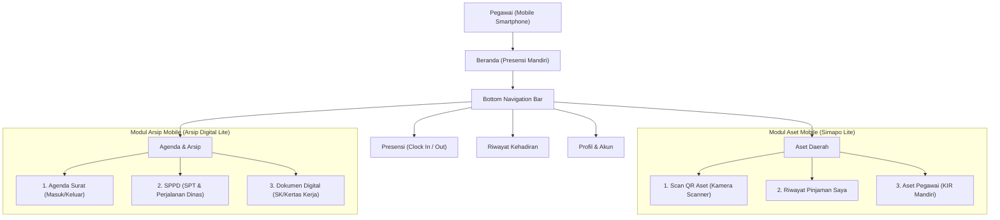

# Product Requirements Document (PRD)
## Modul Mobile: Aset Daerah & Bank Arsip Digital (HADIR Mobile BAPPERIDA)

> **Dokumen:** PRD_ASET_DAN_ARSIP_MOBILE.md  
> **Status:** Final Draft / Ready for Implementation  
> **Target Aplikasi:** `absensi-STICH` (Mobile PWA & Desktop Meja Absen)  
> **Referensi Sumber:** `D:\Code\peta-ekonomi` (`src/components/agenda/`, `src/components/BankData.jsx`) & `D:\Code\absensi` (`js/simapo.js`, `js/arsip.js`, `js/arsip-sppd.js`)  
> **Tanggal:** 15 November 2026 — Sumba Barat, NTT  

---

## 1. Latar Belakang & Tujuan (Objective)

### 1.1 Latar Belakang
Aplikasi presensi mobile aparatur (`index.html`) dirancang untuk penggunaan praktis harian oleh ASN/PPPK BAPPERIDA Sumba Barat melalui smartphone. Agar tidak menjadi monolitik yang membingungkan dan tidak tumpang tindih dengan portal administrasi desktop, fungsionalitas pendukung di mobile disederhanakan secara terfokus:
1. **Layanan Aset Daerah** pada mobile dibatasi hanya pada **3 fungsi esensial**:
   - **Scan QR Aset** (Pemindaian barcode/QR fisik barang inventaris).
   - **Riwayat Pinjaman** (Log permohonan dan status pengembalian barang).
   - **Aset Pegawai** (Daftar barang inventaris resmi yang dipegang/ditanggungjawabkan oleh pegawai yang sedang aktif login).
2. **Bank Arsip Digital** pada mobile diselaraskan dengan arsitektur `peta-ekonomi` yang memuat:
   - **Agenda Surat** (Register surat masuk & keluar kedinasan).
   - **SPPD** (Daftar Surat Perintah Tugas & Perjalanan Dinas pegawai).
   - **Dokumen** (Akses cepat arsip digital & SK kepegawaian).

### 1.2 Tujuan
- Menghilangkan duplikasi fitur dan membersihkan view widescreen desktop yang sebelumnya menumpuk di berkas mobile `index.html`.
- Menyediakan UI/UX mobile yang ringan, ergonomis, berdesain Stitch UI (*clean, zero-slop*), dan terhubung ke API PostgreSQL.

---

## 2. Arsitektur Informasi & Navigasi Mobile

---

## 3. Spesifikasi Fungsional: Modul Aset Mobile

Mengadopsi alur praktis dari `D:\Code\absensi/js/simapo.js` ke antarmuka Stitch UI:

### 3.1 Fitur 1: Scan QR Aset (Pemindai Kamera)
- **Fungsi:** Mengaktifkan kamera belakang ponsel menggunakan pustaka pemindai QR (`jsQR` / native `BarcodeDetector`) untuk membaca label QR code pada barang inventaris BAPPERIDA (laptop, proyektor, kendaraan, dsb.).
- **Alur Pengguna:**
  1. Pegawai menekan tombol *"Scan QR Aset"*.
  2. Bottom Sheet Camera Scanner terbuka dengan reticle fokus dan tombol senter (*torch*).
  3. Saat QR berhasil terbaca (format kode aset: `KAB-SB/BAPPERIDA/{Tahun}/{KodeBarang}/{NUP}`), sistem menampilkan **Detail Kartu Aset**:
     - Nama Barang & Spesifikasi Teknis.
     - Kode Register / NUP & Tahun Perolehan.
     - Lokasi Ruangan fisik saat ini (KIR).
     - Status: *Tersedia*, *Sedang Dipinjam*, atau *Rusak*.
  4. Tombol aksi:
     - Jika tersedia: *"Ajukan Peminjaman"* (membuka form tujuan & durasi pinjam).
     - Jika sedang dipinjam oleh user bersangkutan: *"Konfirmasi Pengembalian"*.

### 3.2 Fitur 2: Riwayat Pinjaman (Loan History)
- **Fungsi:** Menampilkan log permohonan pinjaman barang dinas oleh pegawai terkait.
- **Filter Tab:**
  - `Aktif / Berjalan`: Menampilkan barang yang saat ini sedang dibawa dinas luar dengan sisa hari peminjaman.
  - `Selesai`: Arsip barang yang telah dikembalikan dan diverifikasi Pengurus Barang.
- **Data per Kartu:**
  - Nama barang + badge status (`Menunggu Persetujuan`, `Disetujui`, `Selesai`).
  - Nomor SPT / Keperluan peminjaman.
  - Tanggal pinjam & batas pengembalian.
  - Tautan dokumen digital Berita Acara Serah Terima (BAST).

### 3.3 Fitur 3: Aset Pegawai (KIR Mandiri)
- **Fungsi:** Menampilkan daftar seluruh Barang Milik Daerah (BMD) yang tercatat atas nama NIP pegawai yang login sebagai Penanggung Jawab operasional.
- **Tampilan:**
  - Ringkasan: Total unit aset dipegang, estimasi nilai perolehan, kondisi aset (100% Baik / Perlu Pemeliharaan).
  - Kartu Aset: Gambar/ikon kategori, NUP, Merk/Tipe, Lokasi Meja/Ruangan kerja.
  - Tombol *"Laporkan Kerusakan"* untuk pengajuan perbaikan ke Kasubag Umum.

---

## 4. Spesifikasi Fungsional: Modul Arsip Digital Mobile

Mengadopsi arsitektur dari `D:\Code\peta-ekonomi` (`AgendaSuratPage.jsx` & `AgendaSppdPage.jsx`):

### 4.1 Fitur 1: Agenda Surat (Masuk & Keluar)
- **Fungsi:** Memberikan akses transparansi dan pelacakan surat dinas BAPPERIDA langsung dari smartphone.
- **Pilihan Kategori:**
  - `Surat Masuk`: Tanggal diterima, No. Surat, Asal Instansi/OPD, Perihal, Ringkasan Disposisi Kepala Badan (`Tindak Lanjut`, `Hadiri`, `Arsipkan`).
  - `Surat Keluar`: No. Surat resmi, Tanggal keluar, Tujuan surat, Ringkasan perihal.
- **Aksi Cepat:** Tombol *"Pratinjau PDF"* (membuka pratinjau lembar disposisi / surat resmi).

### 4.2 Fitur 2: SPPD (Surat Perintah Perjalanan Dinas)
- **Fungsi:** Memonitor surat penugasan perjalanan dinas aparatur.
- **Data per Kartu:**
  - No. SPT & No. SPPD resmi (misal: `090/082/BAPPERIDA/2026`).
  - Tujuan dinas (misal: *"Kupang, NTT"* / *"Waikabubak"*).
  - Maksud perjalanan dinas & lama pelaksanaan (hari).
  - Status Verifikasi: `Draf`, `Ditandatangani (TTE BSrE)`, `Selesai`.
  - Tombol aksi: Unduh SPT resmi format PDF.

### 4.3 Fitur 3: Dokumen Digital Kepegawaian
- **Fungsi:** Bank data arsip digital pribadi ASN/PPPK BAPPERIDA.
- **Kategori Folder:**
  - SK Kepegawaian (SK CPNS, SK PNS, SK Kenaikan Pangkat, SK Jabatan).
  - Kertas Kerja & Dokumen Perencanaan (Renja, RKA, Renstra BAPPERIDA).
  - Berkas Presensi & TPP (Slip TPP bulanan ber-TTE).
- **Fitur:** Pencarian instan berdasarkan judul/kata kunci, download berkas terenkripsi aman.

---

## 5. Matriks Integrasi Endpoint API (PostgreSQL Backend)

| Modul | Fitur | Method & Endpoint | Payload / Query Param | Keterangan |
|---|---|---|---|---|
| **Aset** | Scan QR | `GET /api/simapo/item?kode={kode}` | `kode` barcode | Mengambil metadata aset & KIR |
| **Aset** | Ajukan Pinjam | `POST /api/simapo/loans` | `{ nip, barang_id, tujuan, tgl_kembali }` | Insert ke tabel `peminjaman_aset` |
| **Aset** | Riwayat Pinjam | `GET /api/simapo/loans/my` | Session cookie / `nip` | Filter riwayat peminjaman user |
| **Aset** | Aset Pegawai | `GET /api/simapo/pegawai-assets` | `nip={nip}` | Membaca barang inventaris per NIP |
| **Arsip** | Agenda Surat | `GET /api/arsip/agenda` | `tipe=masuk\|keluar&page=1` | Membaca tabel `agenda_surat` |
| **Arsip** | SPPD Pegawai | `GET /api/arsip/sppd/my` | `nip={nip}` | Membaca tabel `agenda_sppd` |
| **Arsip** | Dokumen Digital| `GET /api/arsip/documents` | `kategori={kat}&q={keyword}` | Membaca tabel `dokumen_arsip` |

---

## 6. Standar Desain UI/UX & No AI Slop

1. **Mobile-First Touch Zone:** Seluruh kartu, tab filter, dan tombol aksi dirancang dengan tinggi minimum 44px agar nyaman ditekan jempol.
2. **Bottom Sheet Drawers:** Detail aset dan formulir pengajuan peminjaman meluncur dari bawah sebagai Drawer, tidak mengarahkan ke halaman desktop baru.
3. **Penyelarasan Warna:** Menggunakan biru arsip `#004ac6` sebagai warna primer dan hijau emerald `#10b981` untuk verifikasi sukses.
4. **Data Riil:** Seluruh data merujuk ke tabel database aktif (PostgreSQL `agenda_sppd`, `user_list`, dan inventaris daerah), tanpa data dummy generic.
